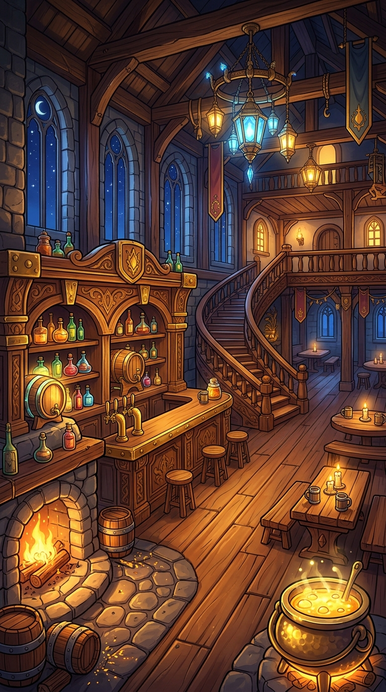
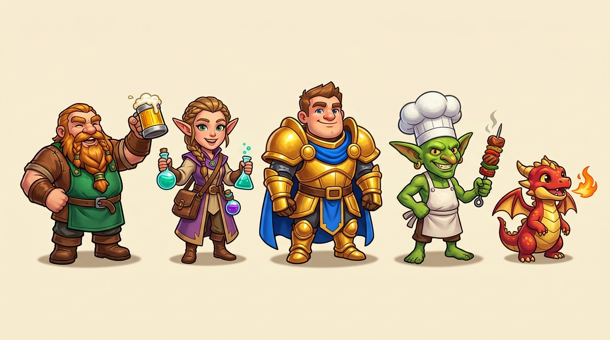
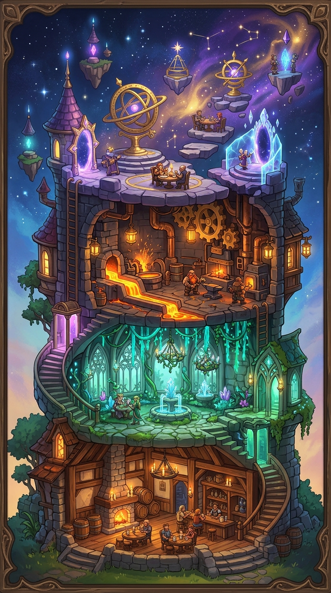
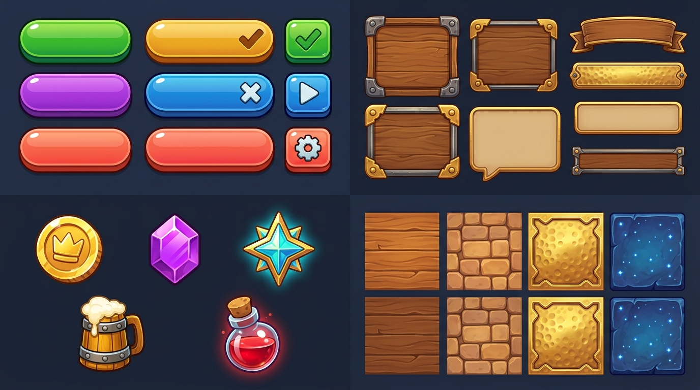
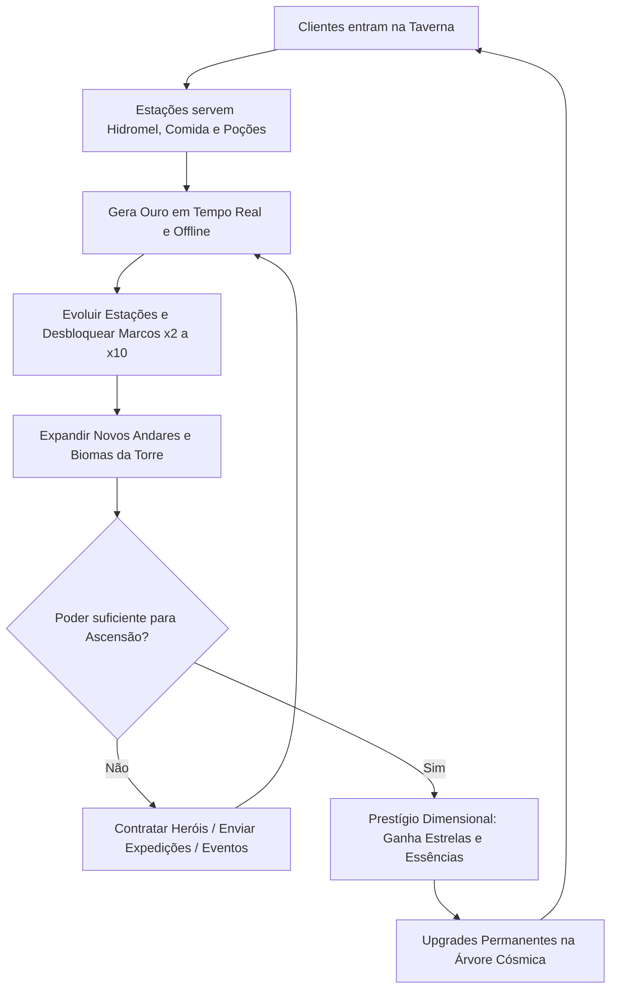
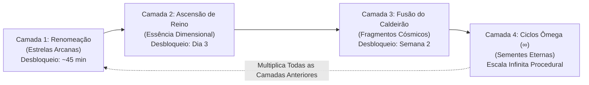
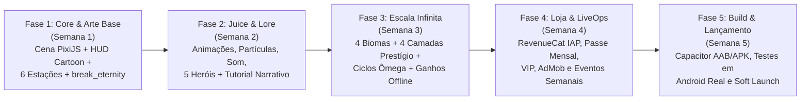

# 🍺 Taverna Infinita: Crônicas do Caldeirão Dourado
> **Game Design Document (GDD) Master — Versão 1.0**  
> **Gênero:** Idle Tycoon RPG / Gestão Fantástica Infinita  
> **Estilo Visual:** 2D Cartoon Estilizado *Hand-Painted* (Nível Supercell / Hearthstone)  
> **Plataforma-Alvo:** Mobile Portrait 9:16 (Android & iOS)  
> **Modelo de Negócio:** Free-to-Play com Microtransações Escaláveis Infinitas (IAP + Assinaturas + Anúncios Premiados Voluntários)

> [!IMPORTANT]
> Este documento é a **Bíblia Completa de Produção** da evolução cartoonizada da **Opção #1 (Tavern Tycoon)**. Ele contém toda a lore pronta, artes conceituais originais, sistema de cores e texturas, fórmulas matemáticas de escala infinita, estratégia de monetização para todos os perfis de jogador e o playbook exato de **Skills do Antigravity** para baixar e construir o projeto com qualidade máxima.

---

## 1. Visão Geral & Pilares de Design

**Taverna Infinita** coloca o jogador no comando de uma taverna mágica construída sobre um artefato ancestral — o **Caldeirão Dourado** — capaz de expandir o estabelecimento verticalmente através de dimensões infinitas. O jogador começa servindo hidromel a aventureiros iniciantes em um salão de madeira aconchegante e evolui até gerenciar uma **Torre Multidimensional de Tavernas** que atende deuses, dragões e viajantes estelares.

### Os 4 Pilares do Jogo
1. **Cartoon Tátil & "Juice" Máximo:** Toda interação tem peso, brilho, partículas e resposta tátil (vibração suave, *squash & stretch*, moedas voando em arco e sons crocantes).
2. **Escalabilidade Verdadeiramente Infinita:** Sem "fim de jogo". O motor matemático (`break_eternity.js`) aliado a 4 camadas de prestígio e ciclos dimensionais procedurais garante progressão perpétua.
3. **Lore Viva & Elenco Carismático:** Cada estação, herói e bioma expande a história do mundo e desbloqueia diálogos curtos e divertidos — nunca paredes de texto chatas.
4. **Monetização Saudável em Todas as Faixas:** Microtransações dinamicamente escaladas ao poder atual do jogador, oferecendo valor real tanto para quem gasta R\$ 4,90 no Dia 1 quanto para veteranos no Dia 1.000.

### Arte Conceitual do Cenário Principal (Fundo da Taverna — 9:16)



---

## 2. Lore Completa & Construção de Mundo (Pronta para o Jogo)

### 2.1 O Mito da Fundação — A Era do Caldeirão Dourado
Há mil anos, o continente de **Valória** era dividido por guerras intermináveis entre Humanos, Elfos, Anões e Dragões. Nenhum exército conseguiu trazer paz — até que um excêntrico arquimago-cozinheiro chamado **Aurelius, o Saciador**, forjou o **Caldeirão de Éter Infinito** na Encruzilhada de **Brasa Clara**.

Em vez de armas, Aurelius conjurou o **Banquete da Concórdia**: um hidromel dourado tão irresistível e poções tão revigorantes que generais inimigos abaixaram as espadas para brindar na mesma mesa. Ao redor do Caldeirão nasceu a primeira **Taverna da Encruzilhada**, território neutro sagrado onde qualquer herói — de qualquer raça ou dimensão — encontrava descanso, missões e comida quente.

Quando Aurelius desapareceu em um portal estelar, o Caldeirão apagou e a taverna caiu no esquecimento... até hoje. Ao herdar as chaves empoeiradas do prédio abandonado, o jovem anão **Barnabé Barba-de-Malte** acende uma fagulha na lareira ancestral. O Caldeirão desperta com um rugido dourado e revela seu verdadeiro segredo: **a taverna não é apenas um prédio, mas uma Torre Dimensional Viva que cresce infinitamente para cima conforme sua fama atravessa os mundos!**

### 2.2 O Conflito — A Guilda do Sal Seco (Sindicato da Cinza)
Para dar ritmo narrativo a eventos semanais, chefes e missões, existe uma facção antagonista cômica e memorável: a **Guilda do Sal Seco**, comandada pelo avarento **Barão Malakor**.
- **Objetivo deles:** Tributar toda comida mágica de Valória e substituir tavernas alegres por "Postos de Ração Cinzenta" sem gosto e superfaturados.
- **Papel no Gameplay:** Toda semana, o Barão envia **Fiscais Goblins, Golems Cobradores e Dragões de Dívida** para tentar fechar a taverna. Os jogadores enviam seus heróis em **Expedições de Defesa** e eventos cooperativos para derrotar o Sindicato e saquear cofres de Gemas Ametista.

### 2.3 Elenco Principal (Personagens & Gerentes Iniciais)



| Personagem | Raça / Função | Personalidade | Especialidade no Gameplay |
| :--- | :--- | :--- | :--- |
| **Barnabé Barba-de-Malte** | Anão • Mestre Taverneiro | Caloroso, risonho, obcecado por espuma perfeita | Automatiza o **Balcão de Hidromel** e aumenta a gorjeta de todos os clientes em $+25\%$ por estrela. |
| **Lyra Folha-de-Luar** | Elfa • Alquimista Chefe | Brilhante, otimista, às vezes explode frascos | Automatiza a **Bancada de Poções**; chance de *Poção Crítica* que vale $\times 10$ em ouro. |
| **Sir Cedric** | Humano • Paladino Dourado | Nobre, dramático, apaixonado por tortas | Lidera o **Mural de Expedições**; traz baús de relíquias e protege a taverna contra raids do Barão. |
| **Zephyr Fogo-Alto** | Goblin • Chef de Cozinha | Frenético, genial, cozinha com fogo de dragão | Automatiza a **Churrasqueira Arcana**; reduz o tempo de preparo de pratos em até $60\%$. |
| **Ignis, a Brasa Real** | Dragãozinho • Mascote Real | Adorável, brincalhão, espirra faíscas douradas | Dorme sob o **Caldeirão Dourado**; ativa o modo *Febre Dourada* ($\times 5$ lucro por 30s) e é a estrela do *Starter Pack*. |

> [!TIP]
> **Escalabilidade de Coleção:** Além dos 5 fundadores, o catálogo de personagens expande continuamente em **7 Tiers de Raridade**: *Comum (Cinza)* → *Raro (Safira)* → *Épico (Ametista)* → *Lendário (Ouro)* → *Mítico (Rubi)* → *Celestial (Ciano Estelar)* → *Eterno (Arco-Íris Prismático)*.

### 2.4 Os Reinos Infinitos da Torre Dimensional



| Bioma / Reino | Andares | Ambientação & Textura | Clientes Típicos | Desbloqueio Narrativo |
| :--- | :--- | :--- | :--- | :--- |
| **1. Brasa Clara** | 1 – 25 | Carvalho esculpido, pedra quente, lareira acolhedora | Camponeses, Escudeiros, Bardos | *"O despertar da primeira fagulha."* |
| **2. Estufa de Sylvandor** | 26 – 50 | Vinhas bioluminescentes, vitrais élficos, fontes de cristal | Druidas, Arqueiros, Fadas Nobres | *"Raízes ancestrais abraçam a torre."* |
| **3. Forja de Khaz-Ouro** | 51 – 100 | Latão rebitado, engrenagens, rios de ouro derretido | Ferreiros Rúnicos, Golems, Artífices | *"Onde o malte é temperado em magma."* |
| **4. Observatório Astral** | 101 – 250 | Pedra estelar azul-violeta, astrolábios dourados, portais | Arquimagos, Viajantes do Tempo, Guardiões | *"A taverna rompe o véu dos céus."* |
| **5. Dimensões $\Omega-N$** | 251 – $\infty$ | Combinações procedurais de paletas cósmicas, auroras e cristais | Titãs, Deuses Menores, Entidades do Vazio | *"O ciclo eterno do Banquete Cósmico."* |

### 2.5 Roteiro Pronto do Tutorial (Primeiros 60 Segundos)
1. **Cena 1 (0–10s):** Câmera foca no salão aconchegante escuro. Barnabé entra correndo com uma tocha: *"Pelos barris de meu avô! O Caldeirão de Aurelius ainda está morno! Toque na lareira para reacender a chama!"*
2. **Cena 2 (10–25s):** Ao tocar, partículas douradas explodem e a iluminação quente acende toda a taverna. Um cavaleiro faminto entra e senta. Barnabé: *"Nosso primeiro cliente! Toque no balcão para servir um Hidromel Espumante!"*
3. **Cena 3 (25–45s):** Moedas saltam com som crocante e voam até o contador. Botão verde esmeralda pulsa com brilho: *"Ótimo! Agora evolua o Balcão para o Nível 2 e contrate a Lyra para servir poções sozinha — mesmo quando você estiver dormindo!"*
4. **Cena 4 (45–60s):** Barão Malakor aparece em uma vinheta cômica ameaçando fechar a taverna em 7 dias. Barnabé ri: *"Vamos construir uma taverna tão alta que nem os impostos dele vão alcançar!"* — **Fim do tutorial, controle 100% livre.**

---

## 3. Direção de Arte Cartoon, Texturas & Design System

### 3.1 Guia Visual & Qualidade de Textura
Para atingir um visual **cartoon premium, colorido e irresistível**, o jogo abandona estética plana (*flat design*) e adota **Cartoon Pictórico Estilizado (*Hand-Painted 2.5D*)**:
- **Contornos Coloridos (*Colored Ink Outlines*):** Nunca usar preto puro (`#000000`). Usar marrom-café profundo (`#2B1810`) para madeira/personagens e azul-meia-noite (`#14192E`) para elementos cósmicos/HUD.
- **Volume Tátil em 3 Camadas:** Cada botão e objeto possui **(1) Brilho Especular Superior** (glossy), **(2) Gradiente Saturado Central** e **(3) Chanfro 3D Inferior (*Bevel*)** com sombra sólida, dando vontade física de clicar.
- **Texturas Ricas & Sem Ruído:** Veios de madeira de carvalho pintados à mão, paralelepípedos arredondados com musgo sutil, ouro martelado com reflexos quentes e pedra estelar cintilante.

### Showcase Oficial de Botões, Molduras, Moedas & Texturas



### 3.2 Paleta de Cores Oficial dos Botões & HUD

| Cor / Papel | Gradiente Principal | Borda / Chanfro 3D | Brilho Especular | Uso Obrigatório na UI |
| :--- | :--- | :--- | :--- | :--- |
| 🟢 **Esmeralda Real** | `#34F075` → `#12A846` | `#0B6B2B` | `#B8FFD0` | Comprar Upgrade, Evoluir Estação, Coletar Lucro, "Confirmar" |
| 🟡 **Âmbar Dourado** | `#FFE055` → `#F2990A` | `#9E5400` | `#FFF7C2` | Loja de Ouro, Baús Grátis, Recompensa Diária, Ofertas Relâmpago |
| 🟣 **Ametista Mística** | `#D361FF` → `#7C2AE8` | `#471094` | `#F3C9FF` | Gemas Premium, Prestígio Dimensional, Clube VIP, Baús Míticos |
| 🔵 **Safira Arcana** | `#44CEFF` → `#1475E1` | `#0A4085` | `#C2EEFF` | Missões, Árvore de Skills, Expedições, Eventos, Botão "Play" |
| 🔴 **Coral Rubi** | `#FF7161` → `#D93025` | `#8A1710` | `#FFC7C0` | Fechar Janela, Configurações, Alerta de Boss Raid, Cancelar |
| 🟤 **Carvalho Quente** | `#8C522B` → `#572F16` | `#2B1810` | `#C98A55` | Molduras de Painéis, Cartões de Estação, Banner de Título |
| 📜 **Pergaminho Claro** | `#FAF0D7` → `#E8D4A8` | `#9E7A4A` | `#FFFFFF` | Fundo de Diálogos, Descrições de Lore, Lista de Receitas |
| 🌌 **Ardósia Real** | `#25304D` → `#151C2E` | `#0B0F1A` | `#3D4E7A` | Backdrop de Modais, HUD Superior de Moedas, Barra de Navegação |

### 3.3 Tipografia & Micro-Interações (*Game Juice*)
- **Fonte de Títulos e Números:** `Lilita One` (ou `Fredoka Bold`) com `text-stroke` `#2B1810` de `2px` e sombra sólida `0px 3px 0px #2B1810` — leitura instantânea mesmo com números gigantes como `42.8 Qi`.
- **Fonte de Corpo / Loja:** `Nunito ExtraBold` para preços, timers e descrições nítidas em telas de 5.5" a 6.9".
- **Física dos Botões (Juice):**
  - *Pointer Down:* `scale(0.93, 0.90)` + `translateY(3px)` (achata o chanfro 3D) + som de "clique de madeira" (`click_wood.ogg`) + vibração tátil leve (`10ms`).
  - *Pointer Up (Compra realizada):* `scale(1.06, 1.04)` → `scale(1)` + explosão de 12 estrelinhas douradas + texto flutuante `+12.5K/s!`.
  - *Botão Premium / Oferta:* Feixe diagonal de brilho branco (`sheen sweep`) passando suavemente a cada 3,5 segundos.
- **Pipeline de Texturas Eficiente:**
  - Todos os painéis e botões usam **9-Slice Scaling** (imagens leves de `128×128px` esticam sem distorcer bordas).
  - Sprites empacotados em **Texture Atlases WebP/PNG** (`2048×2048`) para manter os *draw calls* abaixo de 35 por frame.
  - Cenários desenhados em camadas de paralaxe (Fundo Estrelado → Paredes/Janelas → Balcão/Personagens → Partículas de Fogo/Fumaça em Primeiro Plano).

---

## 4. Core Loop & Arquitetura de Gameplay



### Estações Principais por Bioma (Loop de Expansão)
Cada Bioma possui **6 Estações Evoluíveis** (todas com 4 estágios visuais de arte conforme sobem de nível: *Simples → Decorada → Dourada → Encantada*):
1. **Balcão de Bebidas** (rápido, alto giro, gatilho de combos)
2. **Caldeirão Alquímico** (poções de alto valor e buffs de velocidade)
3. **Cozinha de Brasa** (banquetes que satisfazem grupos de heróis)
4. **Bancada de Forja / Encantamento** (vende equipamentos aos clientes)
5. **Mural de Contratos & Missões** (gera Baús de Heróis e Relíquias)
6. **Camarote VIP Real** (recebe Nobres e Dragões que deixam gorjetas em Gemas e Multiplicadores)

---

## 5. Engenharia Matemática da Escalabilidade Infinita

Para que o jogo **escale infinitamente** sem travar em `Infinity` do JavaScript (`1.79e308`) e mantendo o prazer de progressão por anos:

### 5.1 Motor Numérico (`break_eternity.js`)
- Todos os valores econômicos (Ouro, GPS, Preços, Essências) são representados como instâncias `Decimal` do **`break_eternity.js`**, suportando valores até $10 \uparrow\uparrow 10^{308}$.
- **Formatação Legível no HUD:**
  - $10^3 \dots 10^{33}$: `K, M, B, T, Qa, Qi, Sx, Sp, Oc, No, Dc`
  - $10^{36} \dots 10^{3000}$: Notação alfabética limpa (`aa, ab, ac ... zz`)
  - $> 10^{3000}$: Notação científica estilizada (`1.45e3050`, `e1.2e6`) selecionável nas opções.

### 5.2 Equações Oficiais de Balanceamento

**1. Custo de Upgrade da Estação $i$ no Nível $n$:**
$$C_i(n) = C_{i,0} \cdot r_i^{\,n} \cdot \left(1 + 0.08 \cdot \left\lfloor \frac{n}{50} \right\rfloor\right)$$
Onde $r_i \in [1.07, 1.15]$ (curva exponencial suave que cria paredes naturais resolvidas por marcos, heróis ou prestígio).

**2. Produção por Segundo ($\text{GPS}$) Total:**
$$\text{GPS}_{\text{total}} = \left(\sum_{i=1}^{k} P_{i,0} \cdot n_i \cdot M_{\text{marco}}(n_i)\right) \cdot M_{\text{heróis}} \cdot M_{\text{estrelas}} \cdot M_{\text{constelações}} \cdot M_{\text{VIP}} \cdot M_{\text{evento}}$$
Onde $M_{\text{marco}}(n_i) = 2^{\lfloor n_i / 25 \rfloor} \cdot 3^{\lfloor n_i / 100 \rfloor}$ garante saltos empolgantes a cada 25 e 100 níveis!

**3. Fórmula de Prestígio Camada 1 (Estrelas Arcanas ganhas ao ascender):**
$$\Delta E = \max\left(0,\; \left\lfloor 100 \cdot \left(\frac{\text{OuroAcumulado}}{10^{12}}\right)^{0.38} \right\rfloor - E_{\text{anterior}}\right)$$
Cada Estrela Arcana concede $+10\%$ multiplicativo acumulativo e pode ser investida na **Árvore de Receitas Ancestrais**.

### 5.3 As 4 Camadas de Prestígio Infinito



> [!NOTE]
> **Por que isso gera retenção infinita?** Assim que o jogador domina uma camada, a camada seguinte **automatiza a anterior** (ex: na Camada 2 você desbloqueia o *Auto-Buyer* das estações; na Camada 3 o *Auto-Prestígio*), transformando o jogo de um gerenciador de balcões em um império cósmico cada vez mais profundo sem nunca ficar repetitivo!

---

## 6. Sistema Completo de Monetização Infinita (Microtransações por Nível)

O segredo para monetizar **em todos os níveis do jogador** (do iniciante ao veterano de nível $\Omega$-50) é combinar **produtos permanentes de conforto** + **passes recorrentes** + **pacotes de Valor Dinâmico (Time-Warp & Tier-Scaled)**.

### 6.1 Arquitetura das 4 Moedas
1. **Ouro da Taverna (Soft Currency):** Ganho jogando e offline. Usado em upgrades de estações e novos andares.
2. **Estrelas / Essências (Prestige Currencies):** Ganhas em ascensões. Nunca vendidas diretamente de forma bruta (mantém integridade do jogo), mas podem ser amplificadas por multiplicadores e relíquias.
3. **Gemas Ametista (Hard Currency):** Compráveis na loja e também ganháveis em pequenas doses jogando (missões diárias, conquistas, eventos) para que todos experimentem a loja.
4. **Tickets de Evento & Chaves de Baú:** Usados em eventos semanais contra a Guilda do Sal Seco e no Gacha de Heróis/Relíquias.

### 6.2 Matriz de Microtransações por Faixa de Jogador

| Perfil / Nível do Jogador | Produto / Oferta | Preço Sugerido (BRL) | O que entrega (Escala Dinâmica) | Gatilho Ideal na Jornada |
| :--- | :--- | :--- | :--- | :--- |
| **Nível 0 — F2P Curioso** *(Andares 1–10)* | **Anúncios Premiados (Voluntários)** | Grátis (Receita AdMob) | Boost $\times 2$ Ouro por 2h, Dobrar Ganhos Offline, +15 Gemas do Mercador | Sem anúncios forçados intrusivos! O jogador escolhe assistir. |
| **Nível 1 — Primeira Compra** *(Andares 5–20)* | **Pacote do Aprendiz (Starter Pack)** | R\$ 4,90 | Mascote **Ignis (Épico)** + 250 Gemas + Time-Warp 4h + Moldura Dourada | Aparece após desbloquear a 3ª estação (800% de valor percebido). |
| **Nível 1 — Conforto Essencial** *(Andares 10+)* | **Passe "Sem Anúncios" Vitalício** | R\$ 19,90 | Remove 100% dos anúncios e permite coletar **todos os buffs de vídeo instantaneamente** com 1 toque! | Oferta campeã de vendas em Idle Tycoons. |
| **Nível 2 — Jogador Engajado** *(Reinos 2–3)* | **Passe do Caldeirão (Temporada 30d)** | R\$ 29,90 | 50 níveis de recompensas: Skin exclusiva do mês, Herói Lendário, 3.000 Gemas, +20% velocidade | Renovado todo mês com tema novo (Pirata, Halloween, Natal, Galáctico). |
| **Nível 2 — Assinante Fiel** *(Qualquer Reino)* | **Clube VIP da Taverna (Mensal)** | R\$ 24,90/mês | +100 Gemas/dia ao logar, Offline sobe de 8h para **24h**, +1 Slot de Expedição, Badge VIP | Ideal para receita recorrente previsível (MRR). |
| **Nível 3 — Progressão Acelerada** *(Prestígio 1–2)* | **Caldeirão de Ouro Permanente ($\times 2$)** | R\$ 39,90 | Multiplicador **$\times 2$ permanente** em TODAS as dimensões e prestígios futuros | Oferecido no primeiro Prestígio Dimensional. |
| **Nível 3 — Ofertas de Marco** *(Cada Bioma Novo)* | **Baú de Inauguração de Reino** | R\$ 14,90 – R\$ 49,90 | **Dinâmico:** 24h da sua produção atual + Chaves de Baú do Tier atual + Gemas | Muda automaticamente conforme o Bioma (Estufa, Forja, Astral, $\Omega$). |
| **Nível 4 — Competidor / Endgame Infinito** *(Dimensões $\Omega$)* | **Baú Celestial & Pacote do Arquimago** | R\$ 99,90 – R\$ 249,90 | 10× Invocações Celestiais (Pity Garantido), Time-Warp de 7 dias, Skins Animadas de Bioma, Relíquia Mítica | Escala **infinitamente** com o índice $\Omega$ e eventos de Ranking Global! |

### 6.3 O Mecanismo de "Escala Infinita de Ofertas" (Nunca Fica Obsoleto)
Em jogos mal planejados, um pacote de "100.000 de Ouro" fica inútil na segunda hora de jogo. Em **Taverna Infinita**, **nenhum pacote vende ouro fixo**:
- Todo pacote usa **Capsulas Temporais (Time-Warps)** calculadas na hora da abertura:
  $$\text{OuroRecebido} = \text{GPS}_{\text{atual}} \times \text{SegundosDoWarp} \times M_{\text{bônus}}$$
- Todo Baú de Herói/Relíquia escala o **Nível de Fusão** (Estrelas) sem teto, convertendo duplicatas em *Fragmentos de Transcendência* usados para subir do nível 100 ao infinito.
- **Pity System Transparente:** A cada 10 baús épicos = 1 Épico garantido; a cada 50 baús míticos = 1 Lendário/Celestial garantido. Taxas 100% visíveis (exigência da Apple App Store e Google Play).

---

## 7. Arquitetura Técnica & Stack Recomendada (60 FPS Mobile)

Para criar o jogo **mais bonito, leve e rápido de publicar na Google Play e App Store**, a stack ideal combina renderização WebGL cartoon de altíssima performance com HUD nativa nítida:

| Camada | Tecnologia Recomendada | Por que escolher esta stack? |
| :--- | :--- | :--- |
| **Engine 2D Cartoon** | **PixiJS v8** (WebGL2/WebGPU) | Renderização 2D ultra-rápida em celulares, suporte nativo a spritesheets, partículas, filtros de brilho e 60 FPS estáveis. |
| **HUD, Botões & Loja** | **React 19 + TypeScript + Tailwind CSS** | Botões glossy 9-slice perfeitos em qualquer resolução, transições suaves (`framer-motion`) e desenvolvimento veloz. |
| **Escala Infinita** | **`break_eternity.js`** | Matemática incremental industrial até $10 \uparrow\uparrow 10^{308}$ sem perda de FPS. |
| **Estado & Save** | **Zustand + IndexedDB + Cloud Save** | Autosave a cada 10s com hash de integridade + sincronização na nuvem. |
| **Áudio & Juice** | **Howler.js + Capacitor Haptics** | Efeitos sonoros com variação leve de pitch (evita fadiga auditiva) + vibração física tátil no celular. |
| **Build Android / iOS** | **Capacitor 7** | Empacota em APK/AAB nativo com acesso total à Play Billing, AdMob, Push Notifications e Tela Cheia imersiva. |
| **Monetização (IAP)** | **RevenueCat SDK (`@revenuecat/purchases-capacitor`)** | Gerencia Google Play Billing e Apple StoreKit, valida recibos contra fraudes, oferece Paywalls remotos e analytics de LTV/ARPU. |
| **LiveOps / Backend** | **Supabase** (ou Firebase) | Remote Config (ativa ofertas e eventos sem publicar novo APK), Placar Semanal e Relógio do Servidor (bloqueia trapaça de adiantar data do celular!). |

### Estrutura de Pastas do Projeto
```text
taverna-infinita/
├── .agents/
│   ├── rules/                    # Regras do agente (estilo cartoon, segurança IAP)
│   └── skills/                   # Skills baixadas + skills customizadas do projeto
├── assets/
│   ├── concept/                  # Artes conceituais aprovadas (referência visual)
│   ├── sprites/                  # Atlases WebP 2x/3x (personagens, estações, moedas)
│   ├── ui/                       # Botões 9-slice, molduras de madeira/latão, ícones
│   └── audio/                    # SFX (moedas, espuma, fogueira) + trilhas adaptativas
├── src/
│   ├── engine/                   # PixiJS v8: Cena da Taverna, Paralaxe, Partículas, Câmera
│   ├── economy/                  # break_eternity.js, Fórmulas, Prestígio 4 Camadas, Offline Calc
│   ├── lore/                     # Diálogos, Biomas, Catálogo de Heróis, Eventos do Sindicato
│   ├── monetization/             # RevenueCat, SKUs dinâmicos, Time-Warp, AdMob Rewarded
│   ├── store/                    # Zustand state + persistência criptografada + Cloud Sync
│   └── ui/                       # HUD Cartoon, Botões Juicy, Modais de Loja, Passe & VIP
├── android/                      # Projeto nativo gerado pelo Capacitor (Google Play)
├── ios/                          # Projeto nativo gerado pelo Capacitor (App Store)
└── docs/                         # Documentação sincronizada (GDD, Economia, LiveOps)
```

### Orçamento de Performance Mobile (Metas Obrigatórias)
- **FPS:** 60 FPS constantes (com modo *Economia de Bateria 30 FPS* opcional nas configurações).
- **Memória RAM:** $< 180\text{ MB}$ em pico (libera texturas de biomas inativos automaticamente).
- **Draw Calls:** $< 35$ por frame usando *Sprite Batching* e *Texture Atlases*.
- **Tamanho do APK inicial:** $< 25\text{ MB}$ (ativos dos biomas avançados carregados sob demanda).

---

## 8. Catálogo Completo de Skills para Baixar no Projeto

O Antigravity descobre automaticamente todas as skills colocadas em `.agents/skills/` (ou `~/.gemini/config/skills/`) usando **Progressive Disclosure** (só carrega o contexto quando necessário, mantendo o agente ultra-rápido e preciso).

### 8.1 Skills Externas Recomendadas (Comandos Prontos para Baixar)

Instale estas skills diretamente na raiz do projeto usando o CLI oficial `npx skills`:

| Categoria | Skill | Comando de Instalação | Como eleva a qualidade do jogo |
| :--- | :--- | :--- | :--- |
| **🎨 UI & Paletas Premium** | `ui-ux-pro-max` | `npx skills add nextlevelbuilder/ui-ux-pro-max-skill --skill ui-ux-pro-max` | Garante hierarquia visual, contraste, botões irresistíveis e zero cara de "UI genérica de IA". |
| **🖌️ Design Frontend & HUD** | `frontend-design` | `npx skills add anthropics/skills --skill frontend-design` | Cria componentes React/Tailwind altamente estilizados e responsivos para telas mobile. |
| **🖼️ Composição Visual** | `canvas-design` | `npx skills add anthropics/skills --skill canvas-design` | Direciona composição de telas, banners da loja, ícones e proporções artísticas. |
| **🎮 HUD & UI de Jogos** | `game-ui-design` | `npx skills add https://github.com/omer-metin/skills-for-antigravity --skill game-ui-design` | Especializada em HUD diegética, zonas seguras de toque (*thumb zone*) e layouts portrait mobile. |
| **⚡ Engine 2D PixiJS v8** | `pixijs-skills` | `npx skills add pixijs/pixijs-skills` | Ensina a API exata do **PixiJS v8** (evita bugs de sintaxe antiga v7 e otimiza renderização WebGL). |
| **🏗️ Arquitetura de Jogos** | `game-development` | `npx skills add sickn33/agentic-awesome-skills --skill game-development` | Padrões profissionais: *Fixed Timestep Game Loop*, *Object Pooling* para moedas/partículas, *State Machines*, sub-módulos `2d-games`, `mobile-games`, `game-art` e `game-audio`. |
| **📱 Otimização Mobile** | `mobile-game-dev` | `npx skills add https://github.com/omer-metin/skills-for-antigravity --skill mobile-game-dev` | Controle térmico, memória, fragmentação de telas Android/iOS e conformidade com lojas. |
| **📦 Build Nativo Mobile** | `capawesome-team/skills` | `npx skills add capawesome-team/skills` | Configura Capacitor 7, Haptics, Push Notifications, Status Bar imersiva e build de APK/AAB. |
| **💰 Monetização & IAP** | `rc-claude-code-plugin` | `npx skills add revenuecat/rc-claude-code-plugin` | Integração profissional do **RevenueCat**: compras consumíveis, assinaturas VIP, restauração de compras e paywalls. |

> [!TIP]
> **Comando Rápido (Batch):** Também salvamos um script pronto `scripts/install-skills.sh` na pasta do projeto para baixar todas essas skills de uma vez assim que iniciarmos a codificação!

### 8.2 Skills Customizadas do Projeto (`.agents/skills/`)
Além das skills da comunidade, o projeto deve manter **3 skills próprias** dedicadas às regras únicas de *Taverna Infinita*:
1. **`.agents/skills/tavern-cartoon-art-system/SKILL.md`**
   - Impõe nossa paleta oficial (Esmeralda, Âmbar, Ametista, Safira, Coral, Carvalho), contornos `#2B1810`, botões 3D chanfrados com brilho especular e *Game Juice* em toda nova tela criada.
2. **`.agents/skills/infinite-idle-economy/SKILL.md`**
   - Proíbe uso de `number` nativo do JS para moedas/produção (exige `Decimal` do `break_eternity.js`), força validação de balanceamento e testes unitários de fórmulas de prestígio até $10^{1000}$.
3. **`.agents/skills/iap-liveops-guard/SKILL.md`**
   - Garante conformidade com políticas da Google Play/Apple (exibição de odds de baús, botão "Restaurar Compras", cálculo de Time-Warp seguro via timestamp do servidor para impedir fraude de relógio offline).

### 8.3 Dependências NPM Principais do Projeto
```bash
# Core Visual, UI & Estado
npm install pixi.js react react-dom zustand framer-motion lucide-react

# Matemática Infinita & Áudio
npm install break_eternity.js howler
npm install -D @types/howler

# Empacotamento Nativo Mobile & Monetização Real
npm install @capacitor/core @capacitor/android @capacitor/haptics @capacitor/local-notifications
npm install @revenuecat/purchases-capacitor @capacitor-community/admob
```

---

## 9. Roadmap de Desenvolvimento (Do Protótipo à Play Store)



### Checklist de Qualidade Pré-Lançamento (Definition of Done)
- [ ] Todos os botões seguem a paleta cartoon chanfrada com *squash & stretch* e feedback sonoro/háptico.
- [ ] Economia testada por simulação automatizada do Minuto 1 ao Dia 365 (zero *NaN*, zero paredes impossíveis).
- [ ] Offline earnings validados contra alteração manual de hora do aparelho.
- [ ] Compras sandbox (Google Play License Testing) e "Restaurar Compras" funcionando 100%.
- [ ] 60 FPS estáveis e consumo $< 180\text{ MB}$ RAM em aparelho Android intermediário.
